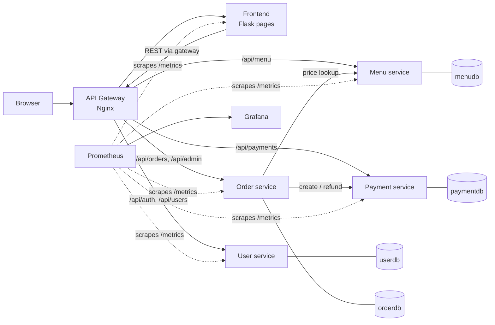

# Architecture

## Diagram

## How the CS50 monolith was split
| Original (`app.py`) | Now |
|---|---|
| `/register`, `/login`, `users` table, password hashing | **User service** (issues JWT) |
| `/menu`, admin menu CRUD, `categories` + `food_items` | **Menu service** |
| `/checkout`, `/orders`, cancel, admin status flow, `orders` + `order_items` | **Order service** |
| *(did not exist — payment was "pay at canteen")* | **Payment service** (new, simulated) |
| Jinja templates, CSS, session cart, CSRF | **Frontend** (no DB; calls the APIs) |
| *(did not exist)* | **Gateway**, health/metrics, containers, K8s, CI/CD |

## Design decisions (and why)
1. **Database per service.** Each service owns its tables; nobody reads another service's DB. Order items therefore store a *copy* of the item name and price (and the username), which also keeps historical orders correct when the menu changes. A side effect: menu items can now be deleted safely.
2. **Authentication with JWT.** The user service signs a token (HS256, 8 h). Every service verifies it with the shared `JWT_SECRET`, so no service needs to call the user service per request. Trade-off: a role change only takes effect when the token expires.
3. **Service-to-service calls over REST.** Checkout: order → menu (current prices, availability) → save order → payment. The browser never supplies prices.
4. **Saga with compensation instead of a distributed transaction.** The order is saved first; if the payment service fails, the order is marked `Cancelled` / `Failed` and the user gets a clear error. Refunds on cancel/reject are best-effort.
5. **API gateway.** One public address, path-based routing, rate limiting (login limited to 5 req/s per IP), request IDs. Backends are not exposed outside the cluster.
6. **Stateless services + external state.** Sessions live in a signed cookie, data in PostgreSQL, so any pod can serve any request → safe horizontal scaling and rolling updates.
7. **12-factor configuration.** All settings (DB URL, secrets, service URLs) come from environment variables; Kubernetes Secrets hold the sensitive ones.
8. **One database engine, two modes.** `common/db.py` uses SQLite for unit tests/local runs and PostgreSQL in containers, selected by `DATABASE_URL`, so tests need no database server.
9. **Observability built in.** Each service exposes `/health` (used for Kubernetes probes), `/metrics` (Prometheus) and writes JSON access logs.

## Known limitations (good to mention in the report)
- One PostgreSQL server with four logical databases (cheap for a student project); production would use separate instances or managed databases.
- Payment is simulated; no message queue / event bus (calls are synchronous).
- JWT secret is shared symmetric; a production system would use asymmetric keys (RS256) or an identity provider.
- Menu images are external URLs; no object storage.
